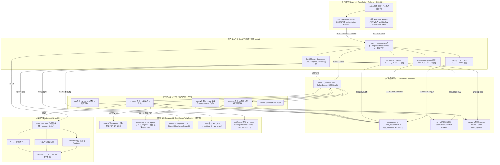
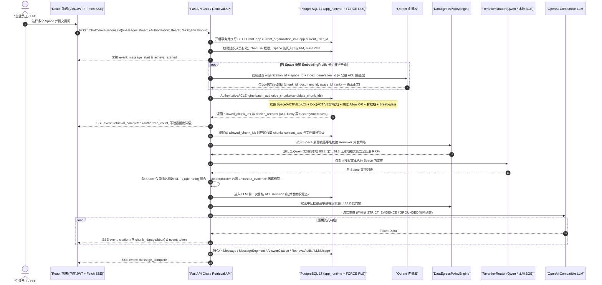
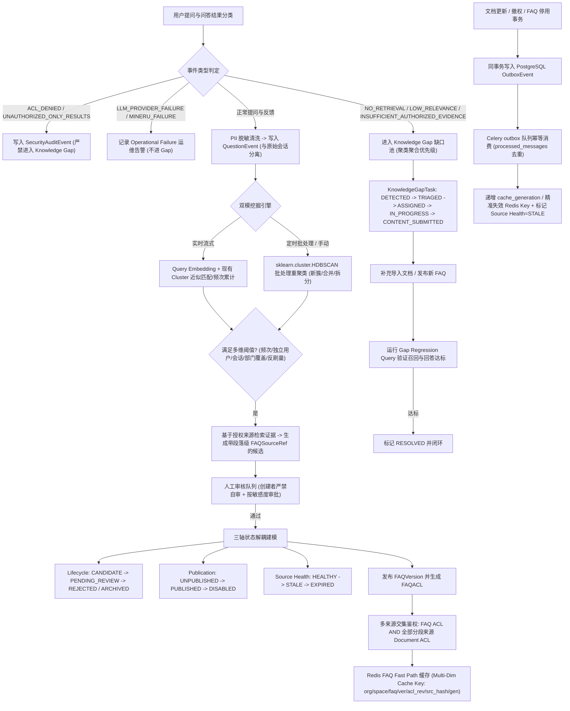

# DocHub 企业级知识库管理与受控 RAG 平台

> **可治理、可审计、可追溯、权限全程一致的企业级多租户知识服务系统**  
> 基于 **FastAPI 模块化单体 + Celery 5 队列隔离 + PostgreSQL 17 双角色 FORCE RLS + Qdrant 混合检索 + MinIO + React/COSS UI** 构建。

---

## 1. 项目定位与核心特性总览

DocHub 的工程目标不是简单的“上传 PDF 后做向量检索聊天”，而是面向企业组织治理构建的一套**全链路权限一致、敏感外发可控、知识闭环可运营**的知识库管理平台：

- **企业级多租户与组织建模**：支持用户加入多个 `Organization`、每次请求严格绑定单一活跃组织上下文；支持邻接表 + Closure Table 部门树、多部门兼职有效期、平台级 `SystemRole`（`SYSTEM_ADMIN` 无业务数据隐式旁路）与组织级 `OrganizationRole` 彻底分离。
- **纵深防御的数据权限内核**：PostgreSQL 17 强制行级安全（`ENABLE + FORCE ROW LEVEL SECURITY`）+ Knowledge Space 入口控制（`PUBLIC` / `PRIVATE`）+ 四维 Document ACL（`GLOBAL` / `DEPARTMENT` 动态与快照 / `ROLE` / `USER` Allow OR）。
- **受控多源解析与结构感知切片**：集成 MinerU 官方云 API（异步任务幂等与断点对账）、6 类本地轻量解析器与 `LocalOCRParserAdapter` 扩展接口；通过 `StructureAwareChunker` 生成保留跨页表头与公式/图片原子边界的 Parent-Child Chunk。
- **零越权混合检索与蓝绿索引**：按 `EmbeddingProfile` 共享 Qdrant Collection（Dense + 中文 jieba BM25 Sparse）；严禁未授权正文进入 Reranker 与 LLM；支持 `IndexGeneration` + `ActiveIndexPointer` 乐观锁蓝绿切换与瞬间回滚。
- **双核心业务闭环（场景 A 与场景 B）**：
  - **场景 A（跨部门财务与薪酬制度问答隔离）**：同一 Knowledge Space 内，“财务报销标准”设为 Space 内 `GLOBAL` 可读，“高管薪酬与股权激励细则”仅授权给 HR 部门与管理层角色。普通员工提问差旅制度可获带页码引用的回答；提问薪酬细则时系统通过 Fail-Closed 拒答且**绝不泄露文档存在性、标题、摘要、搜索建议或引用**；HR/管理层在有效期内可正常检索与溯源。
  - **场景 B（客服 FAQ 沉淀与 Knowledge Gap 闭环）**：针对高频重复提问（如“生鲜食品破损退款规则”），系统对原始问题执行 PII 脱敏后落入 `QuestionEvent`，经实时增量匹配 + 定时 HDBSCAN 重聚类统计频次与独立用户数，生成带段落级来源引用的 FAQ 候选；经人工双人/独立审核（禁自审）后发布至受独立 ACL 与多来源交集权限保护的高速 Fast Path（Redis 缓存由 PostgreSQL Outbox 事件驱动失效）；而“海外直邮保税仓清关延误”等无召回或授权证据不足的问题进入 `KnowledgeGap`（**严格排除 ACL 拒绝与故障类事件**），经补充文档并回归验证达标后关闭闭环。

### 1.1 九条安全红线（发布阻断门禁）

以下任意一项发生，对应版本一律禁止合并与发布（见 [`PRD.md`](PRD.md) §10.1 与 [`.github/workflows/ci.yml`](.github/workflows/ci.yml)）：

1. **严禁未授权 Chunk 进入 Reranker**（必须先经 PostgreSQL `AuthoritativeACLEngine` 批量复核）。
2. **严禁未授权 Chunk 进入 LLM Prompt**（进模型前仍需校验敏感外发与当前 ACL Revision）。
3. **严禁 FAQ 缓存绕过 ACL**（Redis 命中后必须校验 FAQ ACL 与多来源交集权限，Redis 故障时回源 PG 并 Fail-Closed）。
4. **严禁跨 Organization 数据读取**（应用层显式过滤 + PostgreSQL `FORCE ROW LEVEL SECURITY` 双重兜底）。
5. **严禁已撤权用户在重新打开历史对话时读取受限回答**（按 `MessageSegment` 与 `AnswerCitation` 动态重鉴权，不可拆分回答整体隐藏）。
6. **严禁多来源 FAQ 错误扩大来源权限**（多来源运行时取交集授权，禁止宽松 FAQ ACL 覆盖敏感源文档 ACL）。
7. **严禁文档标题、引用、搜索建议、热门排行等旁路暴露受限知识**（列表/搜索/缺口/运营看板严格受控隔离）。
8. **严禁 MinerU / LLM / Embedding / Reranker 外部请求违反敏感级别策略**（`DataEgressPolicyEngine` 统一拦截，L2/L3 扫描 PDF 缺本地 OCR 时强制进入 `BLOCKED_POLICY`）。
9. **严禁前端、Git、日志泄露 API Key、JWT 或其他 Secret**（Access Token 仅驻留内存，`logging.py` 与 OTel Collector 双重脱敏）。

---

## 2. 系统架构与核心流程图（Mermaid）

### 图 1：系统总体架构图



### 图 2：文档多源导入、解析、切片与 Qdrant 蓝绿索引流程图

```mermaid
flowchart LR
    U["单文件直传 / 预签名 PUT / 批量导入"] --> V["服务端防路径穿越 + MIME/SHA-256 校验"]
    V --> Raw["写入 MinIO 私有桶 dochub-raw"]
    Raw --> QStatus["Document 置为 QUARANTINED + 写 ImportJob & OutboxEvent"]

    QStatus --> Worker["Celery ingestion 队列接单"]
    Worker --> Recheck["最后一刻回查 PG 最新 sensitivity_level 与组织外发授权"]
    Recheck --> Route{"ParserRouter 路由判定"}

    Route -->|"Markdown/DOCX/TXT/XLSX/CSV/JSON"| Light["本地轻量解析器 (全本地零外发)"]
    Route -->|"L0 / 已授权 L1 PDF"| MinerU["MinerUOfficialAdapter (idempotency_key + external_task_id 对账)"]
    Route -->|"L2 / L3 / 未授权 L1 纯文本 PDF"| PlainPDF["PlainPdfFallbackParser (本地文本提取)"]
    Route -->|"L2 / L3 扫描 PDF 且 LOCAL_OCR_ENABLED=true"| LocalOCR["LocalOCRParserAdapter (本地 OCR)"]
    Route -->|"L2 / L3 扫描 PDF 且 LOCAL_OCR_ENABLED=false"| Blocked["Fail-Closed 阻断: ParseJob=BLOCKED_POLICY + SecurityAuditEvent"]

    Light --> Artifacts["上传结构化 JSON/Markdown 到 MinIO dochub-artifacts + 写 ParsedBlock"]
    MinerU --> Artifacts
    PlainPDF --> Artifacts
    LocalOCR --> Artifacts

    Artifacts --> Chunker["StructureAwareChunker (Parent-Child 分层 / 跨页表头补全 / 公式图片原子保留)"]
    Chunker --> PGChunk["持久化 ChunkSet & Chunk (含 content_text / page_range / source_block_ids)"]

    PGChunk --> EmbedRoute{"EmbeddingRouter 外发门禁"}
    EmbedRoute -->|"L0 / 授权 L1"| QwenEmb["QwenEmbeddingProvider + jieba BM25 Sparse"]
    EmbedRoute -->|"L2 / L3"| BgeEmb["LocalBGEEmbeddingProvider (单 GPU Semaphore) + jieba BM25 Sparse"]

    QwenEmb --> GenBuild["创建 IndexGeneration (CREATED -> BUILDING -> VALIDATING -> READY)"]
    BgeEmb --> GenBuild
    GenBuild --> QdrantUpsert["写入 Qdrant 共享 Collection (V2 与 V1 共存于同一 Collection)"]
    QdrantUpsert --> Switch["乐观锁更新 ActiveIndexPointer (revision + 1) -> V2=ACTIVE / V1=RETIRED"]
    Switch --> Publish["配置非空 ACL 后发布解除 QUARANTINED -> ACTIVE"]
```



### 图 3：受四维 ACL 与 RLS 保护的 RAG 混合检索与 SSE 问答时序图



### 图 4：FAQ 脱敏挖掘、三轴状态机、缓存失效与 Knowledge Gap 闭环流程图



---

## 3. 技术栈与核心目录结构

### 3.1 核心技术栈

| 分层 | 选型与版本 | 工程职责 |
|---|---|---|
| **前端框架** | React 19 + TypeScript 5.8 + Vite 8 + Tailwind CSS v4 + COSS UI (`@base-ui/react`) | **Notion 风格极简暖白设计系统**（纯白主画布 `#FFFFFF` / 暖灰侧边栏 `#F7F7F5` / 极细分割线 `#E9E9E7`），14 个全功能业务工作台、内存 JWT 状态与 Fetch 流式 SSE |
| **状态与表单** | TanStack Query v5 + React Router v7 + React Hook Form + Zod v4 | 数据缓存同步、路由守卫与强类型表单校验 |
| **后端 API** | Python 3.12 + FastAPI + Pydantic v2 + SQLAlchemy 2.x Async + `asyncpg` | 模块化单体服务、事务级 RLS 会话、61 个已上线 `/api/v1` 路径（73 个 HTTP/SSE 操作）、Idempotency |
| **异步任务** | Celery 5.4 + Kombu（5 条物理隔离队列）+ Celery Beat | 文档解析、向量构建、Outbox 中继与定时 HDBSCAN FAQ 挖掘 |
| **关系数据库** | PostgreSQL 17（`postgres:17-alpine`） | 双角色权限分离、UUID v7 主键、全库 69 张表（68 张领域表 + `alembic_version`，**61 张租户表启用 FORCE RLS**） |
| **向量数据库** | Qdrant（`qdrant/qdrant:latest`）+ `jieba` 中文 BM25 Sparse | 按 Profile 共享 Collection、Dense + Sparse 混合检索与蓝绿切换 |
| **对象存储** | MinIO（`coollabsio/minio:latest`） | 私有桶 `dochub-raw`（原始上传）与 `dochub-artifacts`（解析产物） |
| **缓存与队列** | Redis 7（`redis:7-alpine`, `volatile-lru`） | DB0 业务缓存、DB1 Celery Broker、DB2 Result Backend |
| **解析与模型** | MinerU 官方 API v4 / 6 类本地解析器 / OpenAI 兼容 LLM / Qwen & 本地 BGE | 敏感度门禁路由、`StructureAwareChunker`、单 GPU 并发信号量 |
| **可观测性** | OpenTelemetry + Prometheus + Loki + Tempo + Grafana | 全链路 Trace、指标监控、脱敏日志聚合与总览仪表盘 |

### 3.2 Monorepo 真实目录结构

```text
DocHub/
├── .env.example                          # 环境变量模板（严禁提交真实 .env 与密钥）
├── .github/workflows/ci.yml              # GitHub Actions 合并门禁（Ruff/Pytest/Alembic/Vitest/ACL回归/Secret扫描）
├── docker-compose.yml                    # 分层 Profiles（core / app / observability / full-demo）+ Named Volumes
├── PRD.md                                # 产品需求文档（只读基线）
├── TECHNICAL_SPEC.md                     # 技术规格与数据/接口/安全设计（只读基线）
├── docs/
│   ├── adr/                              # 架构决策记录（ADR-001 ~ ADR-003）
│   └── INTERVIEW_QA.md                   # 32 题深度项目面试 QA 宝典
├── infra/
│   ├── postgres/init-roles.sql           # 初始化 app_migrator 与 app_runtime 最小权限双角色
│   └── observability/                    # OTel Collector、Prometheus、Loki、Tempo 与 Grafana Dashboard 配置
├── scripts/
│   ├── backup.ps1                        # PostgreSQL + MinIO + Qdrant 全量备份与 SHA256 清单生成
│   └── restore.ps1                       # 前置哈希校验、无损恢复演练（-DrillOnly）与受控实库恢复
├── backend/
│   ├── alembic/versions/                 # 单头线性迁移（0001_slice1 / 0002_slice2_3 / 0003_slice4_8，共 68 张领域表）
│   ├── app/
│   │   ├── main.py                       # FastAPI 工厂、CORS 白名单、RequestIdMiddleware、OTel/Prometheus 挂载
│   │   ├── api/v1/                       # /api/v1 聚合路由（61 个路径 / 73 个端点）与 /healthz、/readyz 探针
│   │   ├── core/                         # config, errors, idempotency, ids(UUID v7), logging(脱敏), pagination, security, telemetry
│   │   ├── db/                           # base(TenantMixin), session(org_rls_session/user_rls_session), seed(演示组织与账号)
│   │   ├── workers/                      # celery_app(5 队列拓扑与 Beat 调度)、tasks(流水线任务与 OutboxDispatcherService)
│   │   └── modules/
│   │       ├── identity/                 # Argon2id 登录、Refresh Rotation、重放家族吊销、CSRF、OrgContext
│   │       ├── organizations/            # 多组织管理、成员管理、切换活跃组织
│   │       ├── departments/              # 部门邻接树、Closure Table 维护与防环子树移动、多部门有效期
│   │       ├── roles/                    # 21 项标准权限字典、SystemRole 与 OrganizationRole 彻底分离
│   │       ├── knowledge_spaces/         # PUBLIC/PRIVATE 空间治理、SpaceMembership、SpacePolicy
│   │       ├── acl/                      # AuthoritativeACLEngine 四维 Allow OR、DYNAMIC/SNAPSHOT 快照、Break-glass
│   │       ├── documents/                # MinIO 预签名/直传、Quarantine 隔离、不可变 DocumentVersion、分阶段任务模型
│   │       ├── parsing/                  # ParserRouter、MinerUOfficialAdapter、6 类轻量解析器、LocalOCRParserAdapter
│   │       ├── chunking/                 # StructureAwareChunker（Parent-Child、跨页表头保留、公式图片原子性）
│   │       ├── embeddings/               # QwenEmbeddingProvider / LocalBGEEmbeddingProvider / ChineseSparseVectorizer
│   │       ├── indexing/                 # DocumentIngestionPipeline、QdrantIndexStore、蓝绿 IndexGeneration 与指针回滚路由
│   │       ├── retrieval/                # MultiSpaceHybridRetriever、跨 Space 排名 RRF、ContextBuilder(<untrusted_evidence>)
│   │       ├── providers/                # DataEgressPolicyEngine、OpenAICompatibleLLMProvider、RerankerRouter、脱敏配置路由
│   │       ├── chat/ & citations/        # 受 ACL 保护的 Fetch SSE 问答流、Query Rewrite、段落级历史重鉴权与引用复核
│   │       ├── faq/ & knowledge_gaps/    # PII 脱敏挖掘(HDBSCAN)、禁自审、三轴治理、交集 ACL、Redis 缓存与 11 态 Gap 闭环
│   │       ├── analytics/ & audit/       # 组织隔离运营指标、Benchmark 评测与业务/安全双审计中心
│   │       └── outbox/ & jobs/           # OutboxEvent、ProcessedMessage 幂等去重、IdempotencyRecord、AsyncJob 模型
│   └── tests/                            # 9 个后端 Pytest 测试套件（phase0、slice1~8、parsers/chunking、qdrant_hybrid）
└── frontend/
    └── src/
        ├── App.tsx                       # 14 个 PRD 页面路由树（RequireAuth 守卫）
        ├── config/navigation.ts          # 侧边栏分组与工作台导航契约
        ├── styles/globals.css            # Notion 风格极简暖白设计系统令牌（Tailwind v4 @theme）
        ├── components/ui/                # 源码内聚的 COSS UI 基础组件库（MIT）
        ├── lib/                          # auth-store(纯内存Token)、api-client(401单次静默续期)、sse-client(7类事件解析)
        ├── features/                     # iam, spaces, documents, acl, chat, faq, gaps, governance API 与子组件
        ├── pages/                        # 14 个全中文 Notion 风格业务工作台页面
        └── __tests__/                    # 4 个 Vitest 前端单元与安全/流式回归测试套件
```

---

## 4. 数据库核心域与 PostgreSQL FORCE RLS 安全模型

### 4.1 双角色隔离与事务级 `SET LOCAL`

遵循 [`docs/adr/ADR-002-database-rls-and-docker-capacity.md`](docs/adr/ADR-002-database-rls-and-docker-capacity.md) 与 [`infra/postgres/init-roles.sql`](infra/postgres/init-roles.sql)：

1. **角色职责物理分离**：
   - `app_migrator`：拥有 `public` Schema 建表权限并作为全部业务表 **Owner**，仅用于 Alembic DDL 迁移（`alembic upgrade head`）。
   - `app_runtime`：无 `SUPERUSER`、无 `BYPASSRLS`、**非业务表 Owner**，仅通过 `ALTER DEFAULT PRIVILEGES` 获得业务表 DML 权限，专供 FastAPI API 与 Celery Worker 运行期使用。
2. **为什么必须 `ENABLE + FORCE ROW LEVEL SECURITY`**：防止即使在表 Owner 上下文或特权误操作下绕过策略；配合非 Owner 的 `app_runtime` 角色，确保数据库层成为无法从应用代码旁路的最后防线。
3. **连接池复用零污染机制（`SET LOCAL` + Fail-Closed）**：
   - 业务会话统一通过 [`backend/app/db/session.py`](backend/app/db/session.py) 的 `org_rls_session(session, organization_id, user_id)` 在显式事务首条语句执行 `SELECT set_config('app.current_organization_id', :org_id, true)`（等价 `SET LOCAL`，事务提交或回滚后自动失效），并禁止同一事务内切换租户上下文。
   - 租户表策略统一使用 Fail-Closed 表达式：
     ```sql
     organization_id = NULLIF(current_setting('app.current_organization_id', true), '')::uuid
     ```
     未设置变量时 `NULLIF(..., '')` 返回 `NULL`，任何 `organization_id = NULL` 均为 `UNKNOWN/FALSE`，**默认返回 0 行**。
   - 针对登录前尚未知晓目标组织的 `organization_members` 表，采用 `user_rls_session` 配合双变量策略（`USING (organization_id = ... OR user_id = ...)`，而 `WITH CHECK` 仍严格要求 `organization_id`）。

### 4.2 核心数据库域清单（全库 69 张表，61 张租户表启用 FORCE RLS）

经 [`0001_slice1_iam_rls.py`](backend/alembic/versions/0001_slice1_iam_rls.py)（16 张）、[`0002_slice2_3_space_acl_docs_index.py`](backend/alembic/versions/0002_slice2_3_space_acl_docs_index.py)（25 张）与 [`0003_slice4_8_chat_faq_gap_benchmark.py`](backend/alembic/versions/0003_slice4_8_chat_faq_gap_benchmark.py)（27 张）三次线性单头迁移，数据库共创建 **68 张领域表**（含 `alembic_version` 元数据表共 **69 张表**），其中除 7 张平台级全局表外，**全部 61 张业务租户表均强制包含 `organization_id UUID NOT NULL` 并开启 `ENABLE + FORCE ROW LEVEL SECURITY`**：

| 领域 | 已在 Alembic 落地的表清单（共 68 张领域表 + `alembic_version` = 69 张） | 迁移版本 | RLS 状态 |
|---|---|---|---|
| **平台身份与全局字典** | `users`, `organizations`, `user_sessions`, `permissions`, `system_roles`, `system_role_permissions`, `user_system_roles`（7 张） | `0001` | 平台级全局表 |
| **组织、部门与 RBAC** | `organization_members`, `departments`, `department_closures`, `department_memberships`, `organization_roles`, `organization_role_permissions`, `user_role_memberships`（7 张） | `0001` | **FORCE RLS** |
| **空间与四维 ACL** | `knowledge_spaces`, `space_memberships`, `space_policies`, `document_acls`, `acl_grants`, `acl_grant_department_snapshots`, `acl_revisions`, `break_glass_grants`（8 张） | `0002` | **FORCE RLS** |
| **文档、解析与切片** | `documents`, `document_versions`, `import_jobs`, `parse_jobs`, `parsed_artifacts`, `parsed_blocks`, `chunk_sets`, `chunks`（8 张） | `0002` | **FORCE RLS** |
| **向量与蓝绿索引** | `embedding_providers`, `embedding_profiles`, `index_generations`, `active_index_pointers`, `index_jobs`（5 张） | `0002` | **FORCE RLS** |
| **Outbox / 幂等 / 任务** | `outbox_events`, `processed_messages`, `idempotency_records`, `async_jobs`（4 张） | `0002` | **FORCE RLS** |
| **AI 问答与检索审计** | `conversations`, `conversation_spaces`, `messages`, `message_segments`, `answer_citations`, `retrieval_audits`, `retrieval_candidates`, `retrieval_decisions`, `llm_usages`, `message_feedbacks`（10 张） | `0003` | **FORCE RLS** |
| **FAQ 与三轴治理** | `faqs`, `faq_versions`, `faq_segments`, `faq_source_refs`, `faq_acls`, `faq_reviews`, `faq_publish_records`, `faq_cache_indexes`（8 张） | `0003` | **FORCE RLS** |
| **挖掘与 Knowledge Gap** | `question_events`, `question_clusters`, `question_cluster_members`, `faq_candidates`, `knowledge_gaps`, `knowledge_gap_tasks`（6 张） | `0003` | **FORCE RLS** |
| **审计 / 策略 / 评测** | `audit_events`, `security_audit_events`（2 张，`0001`）；`organization_provider_policies`, `benchmark_runs`, `benchmark_case_results`（3 张，`0003`） | `0001` / `0003` | **FORCE RLS** |

---

## 5. RESTful `/api/v1` 核心接口总览

全平台 **61 个 `/api/v1` 路径（共 73 个 HTTP / SSE 操作端点）** 均已挂载至 [`backend/app/api/v1/router.py`](backend/app/api/v1/router.py) 并投入运行，关键写操作强制校验 `Idempotency-Key`（作用域绑定 `principal + organization + operation`）：

| 领域 | 已上线 HTTP 方法与路径（`/api/v1/*`） | 核心职责与安全机制 | 状态 |
|---|---|---|---|
| **健康探针** | `GET /healthz`、`GET /readyz` | 进程存活与 PG / Redis / MinIO / Qdrant 脱敏连通性探测 | **已上线** |
| **身份认证与账号管理** | `POST /auth/login`、`POST /auth/register`、`POST /auth/change-password`、`POST /auth/refresh`、`POST /auth/logout`、`GET /auth/me`、`GET/POST /users`、`PATCH /users/{user_id}` | Argon2id 校验、自助注册（默认最小 `EMPLOYEE` 权限）、改密吊销其他会话、内存 Access JWT、HttpOnly Refresh Rotation + 重放家族吊销、CSRF 双提交与 `SYSTEM_ADMIN` 全平台账号治理 | **已上线** |
| **组织与部门** | `GET/POST /organizations`、`POST /organizations/{org_id}/switch`、`GET/POST/PATCH /organizations/{org_id}/members`、`GET/POST/PATCH /organizations/{org_id}/departments`、`GET/POST/DELETE .../memberships` | 组织切换、Closure Table 维护、防环子树移动、多部门有效期兼职 | **已上线** |
| **角色权限** | `GET /permissions`、`GET/POST /organizations/{org_id}/roles`、`POST/DELETE /organizations/{org_id}/roles/{role_id}/assign*` | SystemRole 与 OrganizationRole 分离、`SYSTEM_ADMIN` 零业务读旁路 | **已上线** |
| **知识空间** | `GET/POST/PATCH /organizations/{org_id}/spaces`、`GET/PATCH /spaces/{space_id}/members` | `PUBLIC`/`PRIVATE` 可见性、私有空间有效期内显式成员授权 | **已上线** |
| **文档四维 ACL** | `GET /documents/{document_id}/acl`、`GET .../acl/revisions`、`POST .../acl/revisions` | 唯一写入口（ADR-001）：`expected_revision` 乐观锁 + `Idempotency-Key` + 快照展开 + Outbox | **已上线** |
| **文档与版本** | `POST /spaces/{space_id}/documents/uploads`、`POST /documents/uploads/{upload_id}/complete`、`POST /spaces/{space_id}/documents/import-batches`、`GET /documents`、`GET /documents/{id}`、`GET .../versions`、`GET /document-versions/{id}/processing-status`、`POST .../reprocess`、`POST .../publish` | 直传与 MinIO 预签名 PUT、SHA-256 核验、默认 `QUARANTINED` 隔离、非空 ACL 发布解锁 | **已上线** |
| **索引治理** | `POST /indexing/document-versions/{version_id}/process`、`GET /indexing/spaces/{space_id}/pointer`、`POST /indexing/spaces/{space_id}/rollback` | 触发解析切片入库、查询空间激活索引代次、`expected_revision` 乐观锁蓝绿回滚 | **已上线** |
| **AI 问答与引用** | `POST/GET /chat/conversations`、`GET /chat/conversations/{id}`、`POST /chat/conversations/{id}/messages:stream`、`POST /chat/messages/{id}/cancel`、`POST /chat/messages/{id}/feedback`、`GET /citations/{citation_id}` | Fetch Streaming 7 类 SSE 事件、入 LLM 前二次 ACL 复核、段落级历史重鉴权与引用复核 | **已上线** |
| **FAQ 挖掘与缓存** | `POST /faq-mining/runs`、`GET /faq-candidates`、`POST /faq-candidates/{id}/submit-review`、`POST /faq/{id}/reviews`、`POST /faq/{id}/publish`、`POST /faq/{id}/disable`、`GET/POST /faq`、`POST /faq/match` | HDBSCAN 批处理聚类、禁自审、三轴治理、多来源交集 ACL、Redis Fast Path 匹配 | **已上线** |
| **Knowledge Gap** | `GET /knowledge-gaps`、`POST /knowledge-gaps/signals`、`PATCH /knowledge-gaps/{id}/status`、`POST /knowledge-gaps/{id}/tasks`、`PATCH /knowledge-gap-tasks/{id}` | 准入分类器（剔除 ACL 拒绝与故障）、11 态任务流转、Gap Regression Query 闭环验收 | **已上线** |
| **运营/审计/配置** | `GET /analytics/overview`、`GET /analytics/faq`、`GET /analytics/knowledge-gaps`、`GET/POST /benchmarks`、`GET /audit/events`、`GET /audit/security-events`、`GET/PATCH /providers/config` | 组织隔离指标、ACL/RAG Benchmark、业务与安全双审计分离、API Key 尾号脱敏策略配置 | **已上线** |

---

## 6. Windows 原生 + Docker Desktop 快速启动指南

### 6.1 环境前置要求

- **操作系统**：Windows 11（Docker Desktop 开启 Linux Containers / WSL2 后端，建议分配 >= 8 GiB RAM；工程已针对 15.4 GiB 宿主机内存配置 Named Volumes 与容器 `mem_limit`）。
- **本地工具链**：Docker Desktop、`Python >= 3.12, < 3.14`、`Node.js >= 22`、`Git`。

### 6.2 复制 `.env.example` 与密钥/模型配置

```powershell
# 在仓库根目录执行
Copy-Item .env.example .env
```

打开 `.env` 填入真实服务密钥（**严禁将 `.env` 提交到 Git**）：

| 配置组 | 核心环境变量 | 默认/参考值与说明 |
|---|---|---|
| **安全密钥** | `JWT_SECRET_KEY`、`CSRF_SECRET_KEY` | 演示/生产必须替换为 >= 32 位随机高强度字符串 |
| **MinerU 官方 API** | `MINERU_API_BASE_URL`、`MINERU_API_KEY` | 默认 `https://mineru.net/api/v4`；仅在服务端读取，L2/L3 严禁外发 |
| **本地 OCR 预留** | `LOCAL_OCR_ENABLED`、`LOCAL_OCR_ENDPOINT` | 默认 `false`（L2/L3 扫描 PDF 自动触发 `BLOCKED_POLICY` Fail-Closed） |
| **OpenAI 兼容 LLM** | `LLM_BASE_URL`、`LLM_API_KEY`、`LLM_DEFAULT_MODEL` | 默认 `https://100milionseek.top/v1`，模型默认 `gpt-4o-mini` |
| **Embedding / Reranker** | `EMBEDDING_PRIMARY_PROVIDER`、`QWEN_API_KEY`、`LOCAL_BGE_EMBEDDING_ENABLED` | 支持 `qwen` 官方 API（1024 维 `text-embedding-v3` / `gte-rerank`）与 `local_bge`（`BAAI/bge-m3`）双选路由 |

### 6.3 宿主机无冲突端口映射表（全部仅绑定 `127.0.0.1`）

| 服务组件 | 宿主机端口 | 容器内端口 | 所属 Profile | 说明 |
|---|---|---|---|---|
| **PostgreSQL 17** | `15432` | `5432` | `core`, `full-demo` | 规避本机默认 5432 冲突，初始化 `app_migrator`/`app_runtime` |
| **Redis 7** | `16379` | `6379` | `core`, `full-demo` | 规避本机 6379 冲突，开启密码与 `volatile-lru` |
| **MinIO API / Console** | `19000` / `19001` | `9000` / `9001` | `core`, `full-demo` | 自动创建私有桶 `dochub-raw` 与 `dochub-artifacts` |
| **Qdrant HTTP / gRPC** | `6333` / `6334` | `6333` / `6334` | `core`, `full-demo` | 强制启用 `QDRANT__SERVICE__API_KEY` |
| **FastAPI Backend** | `8000` | `8000` | `app`, `full-demo` | Swagger 文档 `/docs`（非 production 环境可用） |
| **Frontend (Nginx)** | `5173` | `80` | `app`, `full-demo` | 访问地址 `http://127.0.0.1:5173` |
| **Grafana** | `13000` | `3000` | `observability`, `full-demo` | 预置 Prometheus/Loki/Tempo 数据源与总览看板 |
| **Prometheus / Loki / Tempo** | `19090` / `13100` / `13200` | `9090` / `3100` / `3200` | `observability`, `full-demo` | 仅本机回环访问 |
| **OTel Collector** | `14317` / `14318` / `18889` / `13133` | `4317` / `4318` / `8889` / `13133` | `observability`, `full-demo` | OTLP gRPC / HTTP、Prom Metrics 与健康检查 |

### 6.4 一键启动与停止脚本（推荐）

仓库根目录已提供 Windows 一键启动与停止脚本（支持双击 `.bat` 或在 PowerShell 执行 `.ps1`）：

```powershell
# 1. 一键启动（默认 dev 模式：拉起 Docker 核心底座 + Alembic 迁移 + 自动种子初始化 + FastAPI 8000 + Celery Worker + Vite 5173）
.\start.ps1
# 或直接双击仓库根目录下的 start.bat

# 2. 首次启动并同步灌入全场景演示数据（文档、Qdrant 向量、FAQ、Knowledge Gap、审计日志）
.\start.ps1 -SeedDemo

# 3. 叠加可观测性栈（Prometheus / Grafana 13000 / Loki / Tempo / OTel）且不自动打开浏览器
.\start.ps1 -WithObservability -NoBrowser

# 4. 全栈 Docker 容器化一键启动（profile: full-demo）
.\start.ps1 -Mode docker

# 5. 一键停止本地应用进程（FastAPI / Celery / Vite）
.\stop.ps1
# 或同时停止 DocHub 的 Docker 容器（保留数据卷，绝不影响本机其他 Docker 项目）
.\stop.ps1 -StopDocker
```

### 6.5 Docker Compose 分层手动启动命令

```powershell
# 1. 仅启动核心数据底座（推荐本地开发 Backend/Frontend 时使用，仅占 ~2.5-3.5 GB 内存）
docker compose --profile core up -d

# 2. 按需叠加可观测性栈（OTel + Prometheus + Loki + Tempo + Grafana）
docker compose --profile core --profile observability up -d

# 3. 完整启动业务应用 + 底座 + 可观测性（全栈演示模式）
docker compose --profile full-demo up -d

# 4. 校验 Compose 语法与健康状态
docker compose --profile full-demo config > $null
docker compose ps
```

### 6.5 数据库迁移、种子数据与本地开发运行

```powershell
# 1. 安装后端依赖（首次）
cd backend
python -m venv .venv
.\.venv\Scripts\Activate.ps1
pip install -e ".[dev]"

# 2. 使用 app_migrator 角色执行 Alembic 单头迁移（绝不用 app_runtime 做 DDL）
alembic heads
alembic upgrade head

# 3. 写入幂等演示种子数据（含 acme-corp / beta-corp 双租户、部门树、角色与 6 个演示账号）
python -m app.db.seed

# 4. 启动 FastAPI 开发服务器
uvicorn app.main:app --host 127.0.0.1 --port 8000 --reload

# 5. 新开终端启动 Celery Worker（5 队列隔离）与 Beat 调度器
celery -A app.workers.celery_app:celery_app worker --loglevel=info --concurrency=2 -Q default,ingestion,indexing,faq,outbox
celery -A app.workers.celery_app:celery_app beat --loglevel=info

# 6. 新开终端启动前端开发服务器
cd ..\frontend
npm ci
npm run dev
```

> **内置演示账号**（由 [`backend/app/db/seed.py`](backend/app/db/seed.py) 初始化，非生产环境默认演示密码为 `DocHubDemo#2026!`，可通过 `DOCHUB_SEED_DEMO_PASSWORD` 覆盖）：  
> `admin@acme.local`、`hr@acme.local`、`employee@acme.local`、`km@acme.local`、`auditor@acme.local`（`acme-corp`）以及 `bob@beta.local`（`beta-corp` 跨租户隔离验证账号）。

### 6.6 全量测试与代码质量校验

```powershell
# 后端代码风格检查与 Pytest 测试（需 core profile 运行中的 PG 17 / Redis）
cd backend
ruff check .
ruff format --check .
pytest -v

# 前端 TypeScript 校验、生产构建与 Vitest 测试
cd ..\frontend
npm run typecheck
npm run build
npm test -- --run
```

### 6.7 备份与恢复演练（PostgreSQL + MinIO + Qdrant）

```powershell
# 1. 执行全量备份（自动导出 pg_dump custom、MinIO 双桶对象与 Qdrant 快照，并生成 SHA256SUMS.txt 与 manifest.json；严禁导出 .env）
.\scripts\backup.ps1

# 2. 推荐：执行无损恢复演练（在临时库 dochub_restore_drill_* 真实恢复并校验表数量、RLS 策略与 app_runtime 非 BYPASSRLS 基线）
.\scripts\restore.ps1 -BackupDir ".\backups\dochub-backup-YYYYMMDD-HHMMSS" -DrillOnly

# 3. 受控实库全量恢复（破坏性操作，必须显式确认 -Force）
.\scripts\restore.ps1 -BackupDir ".\backups\dochub-backup-YYYYMMDD-HHMMSS" -Force
```

---

## 7. 多 Agent Swarm 协同工程实践与测试金字塔（L0–L3）

### 7.1 多 Agent 工程治理规范

依据 [`docs/adr/ADR-001-engineering-governance.md`](docs/adr/ADR-001-engineering-governance.md) 与 [`TECHNICAL_SPEC.md`](TECHNICAL_SPEC.md) §18：

- **独立 Git Worktree 物理隔离**：每个并行角色（`platform`、`backend-core`、`pipeline-rag`、`frontend`、`qa-sec`、`docs-architect`）在各自独立分支与 Worktree 中开发，禁止共享同一可写目录，由主控协调者（`coordinator`）审查 Diff 与安全回归后合入 `main`。
- **契约先行与单一维护者**：公共 Schema、OpenAPI 主契约、Alembic Migration 单头线性演进、ACL 核心策略均指定单一责任者，CI 自动校验 `alembic heads` 数量 `<= 1`，彻底消除双 Head 冲突。
- **反虚假验证红线**：禁止以 Mock 替代真实 PostgreSQL FORCE RLS / MinIO / Qdrant 测试；每个 Vertical Slice 均须跑通真实测试方进入下一阶段。

### 7.2 测试金字塔（L0–L3）

仓库共落地 **10 个后端 Pytest 测试套件（56 个测试集用例）** 与 **4 个前端 Vitest 测试套件（17 个测试集用例）**，总计 **73 个真实自动化用例**，覆盖 Phase 0 至 Slice 8 全链路真实集成验证与 L3 独立安全对抗回归门禁：

| 测试层级 | 覆盖范围 | 仓库内已落地测试文件与门禁 |
|---|---|---|
| **L0（单元与契约测试）** | Pydantic 契约、UUID v7、脱敏日志、`StructureAwareChunker` 表格/公式保留、外发门禁矩阵、SSE 帧解析、UI 组件与内存 AuthStore | [`backend/tests/test_phase0_core.py`](backend/tests/test_phase0_core.py)、[`backend/tests/test_parsers_chunking_providers.py`](backend/tests/test_parsers_chunking_providers.py)、[`frontend/src/__tests__/phase0.test.tsx`](frontend/src/__tests__/phase0.test.tsx)、[`frontend/src/__tests__/slice1-iam.test.tsx`](frontend/src/__tests__/slice1-iam.test.tsx)、[`frontend/src/__tests__/slice2-space-acl-docs.test.tsx`](frontend/src/__tests__/slice2-space-acl-docs.test.tsx)、[`frontend/src/__tests__/slice4-8-workspaces.test.tsx`](frontend/src/__tests__/slice4-8-workspaces.test.tsx) |
| **L1（真实组件集成测试）** | 真实 PG 17 `app_runtime` FORCE RLS 隔离、部门闭包防环移动、Refresh Rotation 重放家族吊销、MinIO 上传与 Quarantine 发布、Qdrant Dense+Sparse 检索与蓝绿指针回滚 | [`backend/tests/test_slice1_iam_rls.py`](backend/tests/test_slice1_iam_rls.py)、[`backend/tests/test_slice2_space_acl_docs.py`](backend/tests/test_slice2_space_acl_docs.py)、[`backend/tests/test_qdrant_hybrid_retrieval.py`](backend/tests/test_qdrant_hybrid_retrieval.py)、[`backend/tests/test_slice3_ingestion_pipeline.py`](backend/tests/test_slice3_ingestion_pipeline.py) |
| **L2（端到端业务闭环测试）** | 场景 A 受 ACL 保护的多 Space RAG 流式问答/撤权与历史重鉴权；场景 B FAQ 脱敏挖掘（HDBSCAN）、禁自审、三轴治理、Redis 缓存失效与 Knowledge Gap 回归验收；运营分析/双审计/Benchmark | [`backend/tests/test_slice4_5_chat_rag_reauth.py`](backend/tests/test_slice4_5_chat_rag_reauth.py)、[`backend/tests/test_slice6_7_faq_gap.py`](backend/tests/test_slice6_7_faq_gap.py)、[`backend/tests/test_slice8_governance.py`](backend/tests/test_slice8_governance.py) |
| **L3（独立安全对抗与 20 并发演练）** | 61 表 FORCE RLS 全检、跨租户 IDOR、ACL 延迟窗口 0 泄露、多来源 FAQ 木桶效应与 Redis 隔离、历史撤权审计落盘、Prompt Injection 隔离、20 并发零污染、`localStorage` 静态扫描与 `restore.ps1 -DrillOnly` | [`backend/tests/test_l3_security_adversarial.py`](backend/tests/test_l3_security_adversarial.py)（10/10 全绿，`ACL Violation = 0`）与 [`.github/workflows/ci.yml`](.github/workflows/ci.yml) `acl-security-regression` 阻断门禁 |

---

## 延伸阅读

- [系统深度面试 QA 宝典（8 大维度 32 题）](docs/INTERVIEW_QA.md)
- [产品需求文档（PRD）](PRD.md)
- [技术规格说明书（TECHNICAL_SPEC）](TECHNICAL_SPEC.md)
- [架构决策记录（ADR-001 ~ ADR-003）](docs/adr/ADR-001-engineering-governance.md)
