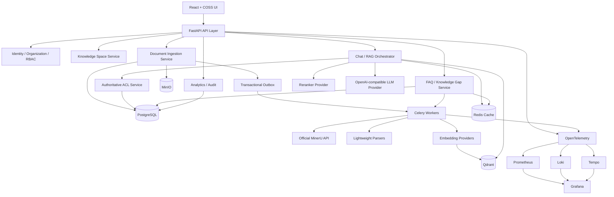

# 知识库管理平台 TECHNICAL_SPEC

> 技术设计规格说明书（Technical Specification）  
> 文档版本：v1.0  
> 需求基线：六轮 Grill Me 访谈  
> 项目代码形态：Monorepo  
> 开发/运行环境：Windows 本机 Antigravity + Docker Desktop  
> 技术状态：CONFIRMED / PROPOSED / TBD 分离管理

---

## 0. 规范和决策控制

### 0.1 状态

- **CONFIRMED**：用户明确选择，禁止擅自改变。
- **PROPOSED**：为满足已确认需求而提出的技术实现，须在实施前通过架构审查。
- **TBD**：未决事项，禁止实现 Agent 用猜测填入生产常量。

### 0.2 关键更正

1. 前端最初选择 Vue 3 + shadcn-vue，后续用户明确要求 COSS UI。COSS UI 官方是 React 组件库，因此本规格采用 React + TypeScript + Tailwind CSS + COSS UI，视为最新选择替代旧 Vue 决策。不得同时维护 Vue 和 React 两套主前端。
2. MinerU 使用用户已有 Key 的官方 API。MinerU API Host/版本/账户能力 TBD；必须先执行 API Contract Spike。
3. MinerU 官方云解析属于外部数据处理。L2 默认本地处理、L3 禁止外发；缺少合规本地 OCR 时应 fail closed。
4. 硬件：Intel i9-13980HX、RTX 4060 8GB、32GB RAM（CONFIRMED，来自既有设备信息及第六轮“没变”）；Docker 预算仍 TBD。

---

## 1. 架构目标与原则

### 1.1 目标

构建面向企业组织知识的模块化服务系统，支持多 Organization、多 Knowledge Space、多源文档导入、文档解析和索引、四维 ACL、混合检索、AI 问答、FAQ 知识沉淀、知识缺口治理、运营审计与可观测性。

### 1.2 架构原则

1. PostgreSQL 是组织、权限、文档元数据、版本、FAQ、会话和审计的权威事实来源。
2. Qdrant 是向量/稀疏检索索引，不是最终授权数据库。
3. MinIO 保存原始文件和解析制品。
4. Redis 是缓存和 Celery Broker，不是长期业务事实来源。
5. MinerU 是外部异步文档解析 Provider，经 Adapter 接入。
6. LLM、Embedding、Reranker 是独立 Provider 能力，分别配置和授权。
7. 文档原始指令、解析文本和检索内容均是不可信数据，不能覆盖系统安全指令。
8. 所有受限内容在进入 Reranker/LLM 之前必须完成权威 ACL 复核。
9. 每次问答、FAQ 命中、历史对话展示都重新验证当前权限。
10. 异步任务至少一次投递，Consumer 幂等；不宣称跨 PostgreSQL、Redis、Qdrant、MinIO、MinerU 的全局 ACID。
11. 资源不足时显式降级或排队，不通过虚假成功、假进度或默认跳过安全检查来保持 UI 正常。

### 1.3 高层逻辑架构（PROPOSED）



此图是逻辑架构，不代表每个方框必须独立部署为微服务。首期服务进程/容器拆分规模 TBD；建议采用模块化单体 API + 独立 Worker/适配器进程。

---

## 2. CONFIRMED 技术基线

| 层 | 已确认技术/约束 |
|---|---|
| Backend | Python + FastAPI + Pydantic |
| ORM/Migration | SQLAlchemy 2.x Async + Alembic |
| Primary DB | PostgreSQL（主版本 TBD） |
| IDs | UUID v7（生成位置依 PostgreSQL 版本确认） |
| Tenant isolation | 应用层 Organization 过滤 + PostgreSQL RLS |
| Object Storage | MinIO |
| Vector DB | Qdrant |
| Task Queue | Celery + Redis |
| Parser | MinerU 官方 API + 轻量解析器 Adapter |
| LLM/Embedding/Reranker | OpenAI-compatible Provider Adapter |
| Frontend | React + TypeScript + Tailwind CSS + COSS UI |
| API | RESTful `/api/v1` |
| Streaming | SSE |
| Authentication | Access JWT 内存保存；Refresh Token HttpOnly Cookie |
| Search | Dense + BM25/Sparse + RRF + Reranker |
| Observability | Prometheus + Grafana + Loki + Tempo + OpenTelemetry |
| CI/CD | GitHub Actions |
| Repo | Monorepo |
| Developer Orchestration | Antigravity 主控 Agent 动态决定子 Agent 分工 |
| Parallelism | 最大 4 个并行 Agent |
| Code isolation | Git Worktree + 分支隔离；主控统一审查合并 |
| Delivery | Vertical Slice 端到端交付 |

---

## 3. 前端技术与工程边界

### 3.1 Framework

- CONFIRMED：React + TypeScript + Tailwind CSS + COSS UI。
- COSS UI 组件源代码按其官方 copy/paste 方式纳入项目，必须记录组件来源与许可证要求。
- PROPOSED：Vite SPA，React Router，TanStack Query，Zod/React Hook Form；以上工具选择需 Phase 0 技术探针确认，不作为已确认决策。
- 不使用 Vue 3/shadcn-vue 作为主 UI。

### 3.2 UI 页面模块

- Authentication / Organization Switcher。
- Dashboard。
- Organization / Department / User / Role Admin。
- Knowledge Space Admin。
- Document Center / Import Drawer / Parser Progress。
- Document Version / Block / Chunk Preview。
- ACL Editor。
- AI Chat Workspace。
- FAQ Mining / Review / Published FAQ。
- Knowledge Gap Queue / Task Detail。
- Analytics / Audit / Benchmark。
- Model & Provider Configuration。

### 3.3 前端安全约束

- 不在前端保存 MinerU API Key、LLM API Key、Embedding Key 或 Reranker Secret。
- Access Token 仅保存在内存，不持久化 localStorage。
- Refresh Token 使用 HttpOnly、Secure、SameSite Cookie，需配套 CSRF 设计。
- 所有 UI 隐藏按钮仅是体验层，后端必须重新进行功能权限与资源 ACL 检查。
- SSE 使用 Fetch streaming 或经验证的同源 Cookie SSE；不得把长期 JWT 放入 URL。
- 引用卡片点击时重新鉴权。

---

## 4. Backend 模块边界

建议 API 作为模块化单体，按领域拆分 Python package：

```text
backend/app/
  api/v1/
  core/                 # config, logging, security, errors
  db/                   # session, base, RLS context, migrations
  modules/
    identity/
    organizations/
    departments/
    roles/
    knowledge_spaces/
    documents/
    parsing/
    chunking/
    embeddings/
    indexing/
    acl/
    retrieval/
    chat/
    citations/
    faq/
    knowledge_gaps/
    analytics/
    audit/
    providers/
    jobs/
    outbox/
  workers/
  tests/
```

模块内允许内部调用；跨模块写操作应通过明确 Service API / Domain Event，不得相互随意直接更新对方表。

---

## 5. 核心数据库模型（逻辑模型，具体列/约束以迁移为准）

### 5.1 Identity / Organization

| Entity | 关键字段（候选） | 说明 |
|---|---|---|
| User | id, email, password_hash, status, created_at | 全平台身份 |
| Organization | id, name, slug, status | 企业组织 |
| OrganizationMember | id, organization_id, user_id, status, joined_at, removed_at | 多对多成员 |
| Department | id, organization_id, parent_id, name, status | 部门邻接树 |
| DepartmentClosure | ancestor_id, descendant_id, depth | Closure Table |
| DepartmentMembership | id, organization_id, department_id, user_id, membership_type, is_primary, status, valid_from, valid_until | 用户多部门关系 |
| SystemRole | id, code, name | 平台级角色 |
| OrganizationRole | id, organization_id, code, name, status | 组织角色 |
| Permission | id, code, description | 功能权限 |
| RolePermission | role_id, permission_id | 功能授权 |
| UserRoleMembership | organization_id, user_id, role_id, valid_from, valid_until, status | 组织角色成员关系 |

### 5.2 Knowledge Space / ACL

| Entity | 关键字段（候选） | 说明 |
|---|---|---|
| KnowledgeSpace | id, organization_id, name, visibility, status, config_version | 空间 |
| SpaceMembership | id, space_id, user_id, status, valid_from, valid_until | 私有 Space 显式成员 |
| SpacePolicy | id, space_id, policy_json, revision | Space 入口策略 |
| DocumentACL | id, document_id, revision, status | 当前 ACL 聚合根 |
| ACLGrant | id, acl_id, subject_type, subject_id, include_descendants, inheritance_mode, valid_from, valid_until, created_by | 四维 Allow Grant |
| ACLRevision | id, acl_id, revision, snapshot_json, changed_by, reason, created_at | 不可变 ACL 历史 |
| BreakGlassGrant | id, organization_id, user_id, scope, reason, expires_at, approved_by, status | 紧急访问 |

`subject_type`：GLOBAL / DEPARTMENT / ROLE / USER。

ACL 主体必须使用强类型 ID、组织边界校验和关联约束。GLOBAL 的作用域是当前 Space。

### 5.3 Documents / Parsing / Chunking

| Entity | 关键字段（候选） | 说明 |
|---|---|---|
| Document | id, organization_id, space_id, title, source_type, status, current_version_id, sensitivity_level | 文档逻辑对象 |
| DocumentVersion | id, document_id, version_no, source_object_key, file_sha256, mime_type, size_bytes, created_by, created_at | 不可变版本 |
| ImportJob | id, document_version_id, status, idempotency_key, error_code | 导入生命周期 |
| ParseJob | id, document_version_id, parser_provider, parser_version, external_task_id, status, tier, error_detail | 解析任务 |
| ParsedArtifact | id, document_version_id, artifact_type, object_key, sha256, metadata_json | JSON/Markdown/PDF 渲染 |
| ParsedBlock | id, document_version_id, block_type, page_number, heading_path, content_ref, bounding_box, metadata_json | 结构化 Block |
| ChunkSet | id, document_version_id, chunker_version, config_hash, status | 一套切片结果 |
| Chunk | id, chunk_set_id, document_version_id, parent_chunk_id, content_ref, content_hash, token_count, source_block_ids, page_range, metadata_json | Parent/Child Chunk |

Chunk 正文权威存储位置（PostgreSQL 正文列还是 MinIO/其他对象存储）仍需结合内容长度、检索频率与备份成本验证；Qdrant Payload 存全文索引所需文本，但应用最终读取正文必须经 ACL。

### 5.4 Embedding / Index

| Entity | 关键字段（候选） | 说明 |
|---|---|---|
| EmbeddingProvider | id, provider_type, base_url_ref, enabled | Provider 注册 |
| EmbeddingProfile | id, provider_id, model_id, model_version, dimensions, language_config, status | 向量模型配置 |
| IndexGeneration | id, embedding_profile_id, collection_name, generation_no, chunker_version, status, metrics_json | 索引构建版本 |
| ActiveIndexPointer | id, scope_type, scope_id, embedding_profile_id, index_generation_id, revision | 当前激活索引 |
| IndexJob | id, generation_id, status, progress, error_code | 构建任务 |

Collection 按 Embedding Profile 共享，Point Payload 至少含 organization_id、space_id、document_id、document_version_id、chunk_id、index_generation_id、acl_revision 等字段。Payload 过滤只是预过滤，不代替 PostgreSQL 权威 ACL。

### 5.5 Conversation / Retrieval Audit

| Entity | 关键字段（候选） | 说明 |
|---|---|---|
| Conversation | id, organization_id, user_id, title, status, created_at | 会话 |
| ConversationSpace | conversation_id, space_id | 会话选择 Space |
| Message | id, conversation_id, role, content, status, created_at | 消息 |
| MessageSegment | id, message_id, sequence, content, segment_type | 可重鉴权的回答片段 |
| RetrievalAudit | id, message_id, query_hash, retrieval_config_version, policy_revision, latency_ms | 检索审计 |
| RetrievalCandidate | audit_id, chunk_id, per_space_rank, retrieval_source, score_metadata | 候选引用，不存未授权正文 |
| RetrievalDecision | audit_id, chunk_id, decision, reason_code, acl_revision | 授权判定 |
| AnswerCitation | id, message_segment_id, document_version_id, chunk_id, page_number, block_id, bbox_json | 引用定位 |
| LLMUsage | id, message_id, provider, model, prompt_tokens, completion_tokens, latency_ms, cost_metadata | 用量审计 |

受限拒绝详情仅授权给 Security Auditor；普通用户可见日志不得包含受限文档标识或标题。

### 5.6 FAQ

| Entity | 关键字段（候选） | 说明 |
|---|---|---|
| FAQ | id, organization_id, space_id, lifecycle_state, publication_state, source_health_state, current_version_id | FAQ 主对象 |
| FAQVersion | id, faq_id, version_no, question, answer_hash, created_by, created_at | 不可变版本 |
| FAQSegment | id, faq_version_id, segment_no, content_type, content_ref, metadata_json | 结构化答案片段 |
| FAQSourceRef | id, faq_segment_id, document_version_id, chunk_id, citation_ref | 段落来源 |
| FAQACL | id, faq_id, revision, policy_snapshot | FAQ 独立 ACL |
| FAQReview | id, faq_version_id, reviewer_id, decision, review_type, comments, policy_version, reviewed_at | 审核历史 |
| FAQPublishRecord | id, faq_id, faq_version_id, published_by, published_at, status | 发布事实 |
| FAQCacheIndex | faq_id, faq_version_id, acl_revision, cache_generation, updated_at | 缓存版本映射 |

FAQ 生命周期、发布状态、来源健康状态分离，避免单一枚举无法表达“已发布但来源过期”等复合情况。

### 5.7 FAQ Mining / Knowledge Gap

| Entity | 关键字段（候选） | 说明 |
|---|---|---|
| QuestionEvent | id, organization_id, space_id, user_hash, session_hash, normalized_text_ref, sensitivity, created_at | 脱敏问题事件 |
| QuestionCluster | id, scope_key, algorithm_version, cluster_version, status, metrics_json | 聚类 |
| QuestionClusterMember | cluster_id, question_event_id, membership_score | 问题与簇关系 |
| FAQCandidate | id, cluster_id, candidate_status, generated_answer_ref, confidence_json | FAQ 候选 |
| KnowledgeGap | id, organization_id, space_id, cluster_id, status, priority, first_seen_at, last_seen_at | 知识缺口 |
| KnowledgeGapTask | id, gap_id, assignee_id, status, priority, due_at, related_document_id, resolution_evidence | 补充任务 |

ACL Deny 事件不写入普通 KnowledgeGap；可记录为独立 SecurityAuditEvent。

### 5.8 Jobs / Audit / Outbox

- AsyncJob：统一任务跟踪，但 ImportJob/ParseJob/IndexJob 的领域状态仍独立。
- OutboxEvent：与业务事实同事务提交。
- Inbox/ProcessedMessage：Consumer 幂等记录。
- AuditEvent：业务审计。
- SecurityAuditEvent：ACL Deny、权限变更、Break-glass、越权尝试。
- BenchmarkRun / BenchmarkCaseResult：测试集和运行结果。

---

## 6. 权限内核

### 6.1 当前 Organization Context

每个 API 请求必须解析并绑定一个 active Organization：

- 用户必须是当前 Organization 的有效成员。
- 默认一个请求只使用一个 Organization Context。
- 不允许基于用户多组织身份自动合并 ACL。
- Worker 消息必须携带 Organization ID、业务资源 ID 和任务发起上下文；Worker 从数据库重新验证成员/策略事实，不能信任消息内的权限结论。

### 6.2 Space Access 与 Document ACL

建议判定顺序：

1. 身份有效、当前 Organization 成员有效。
2. Space 属于当前 Organization 且处于 Active。
3. 检查 Space 公共/私有入口策略。
4. 检查 Document 状态、敏感等级和发布状态。
5. 计算四维 Allow OR。
6. 任何无法确认的状态均拒绝。

Space 公开/私有的完整细则是 PROPOSED，需要在实施阶段把 Space Membership 的默认语义固化为测试。

### 6.3 ACL 公式

```python
allowed = (
    global_grant_matches(user, space)
    or department_grant_matches(active_department_memberships, document)
    or organization_role_grant_matches(active_roles, document)
    or user_grant_matches(user, document, now)
)
```

`department_grant_matches` 需要支持：
- exact department match；
- include_descendants；
- inheritance_mode = DYNAMIC / SNAPSHOT；
- membership valid_from/valid_until；
- Department Closure Table 当前状态或授权时快照。

用户多部门和多角色的有效授权采用并集。

### 6.4 ACL 版本和失效

每次 ACL 变更在 PostgreSQL 事务中：
1. 锁定 DocumentACL。
2. 递增 revision。
3. 写入 ACLRevision 不可变快照和 Diff。
4. 写入 Outbox Event。
5. 提交事务。

Qdrant Payload 更新异步进行。检索请求始终根据 PostgreSQL 当前 ACL Revision 做最终校验；索引同步延迟最多导致漏召回，不允许越权。

### 6.5 Qdrant 预过滤 + PostgreSQL 最终鉴权

```text
Qdrant Dense/BM25 Candidate Search
    -> candidate IDs + safe metadata only
    -> PostgreSQL current ACL batch check
    -> discard denied IDs
    -> fetch authorized chunk body
    -> Reranker
    -> LLM context
```

禁止：
- 未授权内容进入 Reranker。
- 将 Qdrant 直接返回的文本无条件拼接 Prompt。
- 普通日志记录未授权正文、标题和路径。

### 6.6 Break-glass

CONFIRMED：存在限时紧急访问能力，需理由和独立审计。

TBD：是否强制双人批准、最大持续时间、可授权范围、是否允许跨 Space。未确定前按默认拒绝处理，不实现隐式管理员万能旁路。

### 6.7 敏感等级外发策略

默认：
- L0：允许外部 Provider。
- L1：Organization 明确授权后允许。
- L2：默认本地处理。
- L3：禁止外发。

Organization 只能收紧。所有外发调用前必须进行 Data Egress Policy Check，并记录 Provider、Model、用途、数据级别、决策版本和调用标识。

MinerU 官方云 API 对 L2/L3 默认禁止。对于 L2/L3 扫描 PDF，若没有本地 OCR 方案，任务应进入 `BLOCKED_POLICY`/人工处理，不得降级为外发。

### 6.8 权限撤销竞态

CONFIRMED：LLM 请求前重新验证权限；已经发送给外部模型的内容不能保证被追回。

建议：
- 请求阶段保存 ACL Revision Snapshot。
- 进入 LLM 前再次批量验证。
- 生成期间收到撤权事件，可尝试取消请求；是否强制取消仍可配置/TBD。
- 历史会话打开时重新鉴权 MessageSegment 和 Citation。
- 无法可靠拆分来源的敏感回答，撤权后整体隐藏。

---

## 7. 文档导入与 MinerU Adapter

### 7.1 服务流程

```text
Client Upload
  -> API validates user / org / space / file
  -> MinIO object write
  -> SHA256 / MIME / size verification
  -> DocumentVersion + ImportJob transaction
  -> Outbox event
  -> Celery worker
  -> Sensitivity / Egress policy gate
  -> Parser Router
       ├── MinerU Official API Adapter (complex PDF, scanned PDF, tables, formulas)
       ├── DOCX parser
       ├── Markdown parser
       ├── TXT parser
       ├── XLSX/XLS parser
       ├── CSV parser
       └── JSON parser
  -> Artifact download
  -> MinIO artifact storage
  -> Structured Block normalization
  -> Chunking
  -> Embedding
  -> Qdrant IndexGeneration
  -> ACL/index validation
  -> set active pointer / publish document
```

### 7.2 MinerU Official API Adapter

必须实现统一接口（示例）：

```python
class DocumentParser(Protocol):
    async def submit(self, request: ParseRequest) -> ParseSubmission: ...
    async def get_status(self, external_task_id: str) -> ParseStatus: ...
    async def fetch_result(self, external_task_id: str) -> ParseArtifactBundle: ...
    async def cancel(self, external_task_id: str) -> CancelResult: ...
```

配置项：
- `MINERU_API_BASE_URL`（TBD，以用户账户官方文档为准）
- `MINERU_API_VERSION`（TBD）
- `MINERU_API_KEY`（Secret，不提交 Git）
- 请求超时、轮询间隔、最大重试、最大并发和预算（TBD）

官方 API 文档描述的基本模式是：创建异步任务、上传文件、轮询状态、下载解析结果；使用 Bearer API Key。API Key 不能放进前端或公开仓库。具体 endpoint、字段、文件限制和输出格式必须根据账户实际服务文档确认，不能在不同 MinerU API 文档/部署形态之间混用。

### 7.3 MinerU 任务恢复

- 创建外部任务前，先持久化本地 ParseJob 和 Idempotency Key。
- 外部任务 ID 回写数据库。
- Worker 崩溃后通过原 external_task_id 查询，不应直接重新提交同一文件。
- API 超时后区分“服务端可能已接收”与“明确未接收”。结果不明时先对账。
- 解析结果下载后计算 Hash，并保存原始压缩包/必要产物。
- 对过期下载链接要按官方 API 语义重新查询；不可假定链接永久有效。

### 7.4 MinerU API Contract Spike（Phase 0 必做）

在真实开发前完成：
1. 从账户控制台/官方文档确定 API Host 和版本。
2. 检查 Key 权限、套餐、页数/文件大小限制和并发限制。
3. 用无敏感测试 PDF 创建任务。
4. 验证上传、轮询、失败状态和取消语义。
5. 下载并检查 JSON、Markdown、图片、页码和 Bounding Box。
6. 记录真实请求/响应 Schema（脱敏）。
7. 将契约写成 Adapter 集成测试与 Fixture。

### 7.5 上传策略

- 小文件可由 FastAPI 代理上传。
- 大文件/批量文件使用 MinIO 预签名 URL/Multipart Upload。
- 上传路径阈值 TBD。
- Object Key 由服务端生成，包含不可猜测 ID，不允许客户端传路径穿越值。
- 上传完成服务端 HEAD/GET 检查实际大小、Hash、MIME 和归属。

### 7.6 文档处理状态机

拆分多个状态机：

**ImportJob**：CREATED → UPLOADING → VERIFYING → QUARANTINED / REJECTED / FAILED。

**ParseJob**：QUEUED → SUBMITTING → SUBMITTED → RUNNING → SUCCEEDED / FAILED / CANCEL_REQUESTED / CANCELLED / UNKNOWN / BLOCKED_POLICY。

**ChunkingJob**：QUEUED → RUNNING → SUCCEEDED / FAILED。

**EmbeddingJob**：QUEUED → RUNNING → SUCCEEDED / FAILED。

**IndexJob**：CREATED → BUILDING → VALIDATING → READY → ACTIVE → RETIRED / ROLLED_BACK / FAILED。

状态枚举和迁移表是实施契约；不得通过一个总 status 覆盖所有子阶段。

---

## 8. Chunking / Embedding / Qdrant

### 8.1 Chunking

- Structure-aware + Parent-Child。
- Document 默认 ACL 继承到全部 Block/Parent/Child Chunk。
- Chunk 参数由默认模板、文档类型策略和 Space Override 组合。
- 参数值 TBD；通过 Parser/RAG Benchmark 优化。
- Chunk Set 绑定 `chunker_version` 和 config hash。

### 8.2 Embedding Provider

Provider 抽象至少包括：
- `embed_documents(texts, profile)`
- `embed_query(query, profile)`
- capability metadata：dimension、max input tokens、language、normalization、batch size。

Generation、Embedding、Reranker Provider 独立配置，不要求来自同一供应商。

### 8.3 Embedding 多 Space 查询

每个 Space 可有自己的 Embedding Profile。一次选择多个 Space 时：
1. 按 Space/Index Profile 分组。
2. 对每种 Profile 生成对应 Query Embedding。
3. 在各 Profile Collection 执行 Dense/BM25。
4. 每个 Space 内独立 RRF。
5. 候选 ID 进行 PostgreSQL ACL 复核。
6. 只读取授权正文。
7. 可按 Space Rerank。
8. 跨 Space 使用基于排名的 RRF，不直接比较异构模型 raw score。
9. Context Builder 按 token budget 与来源多样性组装。

### 8.4 Qdrant Payload

候选字段：

```json
{
  "organization_id": "uuid",
  "knowledge_space_id": "uuid",
  "document_id": "uuid",
  "document_version_id": "uuid",
  "chunk_id": "uuid",
  "parent_chunk_id": "uuid-or-null",
  "index_generation_id": "uuid",
  "acl_revision": 12,
  "sensitivity_level": "L1",
  "language": "zh-CN",
  "text_for_bm25": "...",
  "dense_vector": "configured vector name",
  "sparse_vector": "configured sparse vector name"
}
```

Qdrant Payload 文本视为敏感数据存储，访问控制、磁盘卷、备份和管理端口必须限制。即便 Qdrant 返回文本，也不能直接把文本交给模型；正文读取必须经过权威 ACL。

### 8.5 Collection 策略

CONFIRMED：按 Embedding Profile 创建共享 Collection，使用 Payload 隔离 Organization/Space。

TBD：每个 Profile 的 Collection 生命周期、Named Vector 是否用于 profile 内变体、Shard/分片方式、数据规模阈值。

### 8.6 蓝绿索引迁移

- V1 Active 不被覆盖。
- V2 Staging 全量构建。
- 运行 Parser/Chunker/Embedding/Retrieval/ACL Benchmark。
- 更新 ActiveIndexPointer（带乐观锁/revision）。
- 保留 V1 用于回滚，直到保留策略允许清除。
- Qdrant collection alias 只能在数据库 Active Pointer 的事务/协调规则下更新，避免多个事实源。

---

## 9. Retrieval / Reranker / Answer

### 9.1 Hybrid Retrieval

- Dense Vector Search。
- Qdrant BM25 Full Text Search。
- 自定义中文 Sparse/Tokenizer 优化路线。
- RRF 结果融合。
- Reranker 对授权后候选进行排序。

Top-K、RRF 常数、Sparse 配置、中文分词器和 Reranker 阈值 TBD。

### 9.2 安全执行顺序

禁止将未授权正文发送给 Reranker 或 LLM：

1. Qdrant 只产生候选 ID 和受控元数据。
2. PostgreSQL 批量校验 Space Access、Document Status、四维 ACL、有效期、当前 Revision。
3. 丢弃拒绝项。
4. 从权威正文存储读取通过授权的 Chunk。
5. 只对通过授权的文本调用 Reranker。
6. 再由 Context Builder 选择进入 LLM 的证据。

### 9.3 Multi-Space Fusion

- Space 级检索独立执行。
- 每个 Space 使用自己的 Embedding Profile。
- 空间内 RRF，然后授权和排序。
- 跨空间以排名 RRF 融合。
- 不允许未授权候选影响最终可见结果、回答或普通运营指标。

### 9.4 Query Rewrite / Multi-Query

- 每轮消息保留原始 Query。
- Query Rewrite 生成用于检索的独立 Query，不覆盖用户原文。
- Multi-Query 可生成多条查询；数量 TBD。
- 所有派生 Query 继承原用户权限上下文。
- 每轮检索均重新鉴权。

### 9.5 Answer Policy

Knowledge Space 配置回答模式：
- STRICT_EVIDENCE：只能依据授权证据回答；证据不足则拒答/缺口提示。
- GROUNDED_WITH_GENERAL_CONTEXT：允许通用知识补充，但需显式标注非知识库证据。

默认模式尚未被用户单独确认。PROPOSED：STRICT_EVIDENCE 作为新建 Knowledge Space 的初始默认；具体默认值与 Space 覆盖规则在配置冻结前标记 TBD。

### 9.6 Citation

Citation 最少绑定：document_version_id、chunk_id、block_id、page_number、bbox、quote hash、ACL Revision。

点击引用/打开历史引用时重新鉴权。页面高亮需要有原始 PDF 页面渲染制品和准确坐标；无法准确定位时显示页码/章节，不得伪造高亮。

### 9.7 SSE

推荐用 Fetch Streaming 携带 Authorization Header。

事件 Schema 示例：

```json
{"event":"message_start","data":{"message_id":"..."}}
{"event":"retrieval_started","data":{"space_ids":["..."]}}
{"event":"retrieval_completed","data":{"authorized_count":3}}
{"event":"citation","data":{"citation_id":"...","document_title":"authorized title","page":12}}
{"event":"token","data":{"text":"..."}}
{"event":"message_complete","data":{"usage":{"prompt_tokens":0,"completion_tokens":0}}}
{"event":"message_error","data":{"code":"...","retryable":false}}
```

示例仅用于说明类型；正式字段由 OpenAPI/Pydantic contract 冻结。未授权资源不出现在任何 SSE data。

---

## 10. FAQ Mining / Lifecycle / Cache

### 10.1 Mining Modes

- Real-time: 新问题 Embedding + 现有 Cluster 近似匹配/增量指派。
- Scheduled: HDBSCAN 批处理重聚类、发现新簇、合并/拆分。
- Manual: 管理员指定范围和时间窗口触发。

HDBSCAN 的增量近似分配不等于自动发现新簇；新簇形成/拆分/合并依赖批量重聚类。参数和周期 TBD。

### 10.2 Question Privacy

- 原始用户问题可能包含 PII 或敏感信息。
- 聚类输入先脱敏，QuestionEvent 与聚类样本分开存储。
- 用户删除请求、Organization/Space 分析开关、保留期限必须进入治理规则。
- 跨权限匿名聚类只允许统计聚合，不将跨权限原始文本合并为可见候选答案。
- 最小群体数和差分隐私方案 TBD。

### 10.3 FAQ Threshold

支持配置：
- total_frequency_threshold
- unique_user_threshold
- unique_session_threshold
- department_coverage_threshold
- time_window
- min_cluster_confidence
- anti_spam_limit

配置层级：Global Default → Organization Override → Space Override。数值 TBD。

### 10.4 FAQ Candidate Generation

- 聚类后从当前用户/审核上下文允许的知识来源中检索证据。
- 来源 ACL 必须先验证。
- LLM 只使用当前审核策略允许的证据。
- 生成结构化 FAQ Segment 和来源引用。
- Citation Validation 失败、证据不足或无法确认来源时不得作为可发布答案。
- 候选置信度是多项评估信号，不得将单一向量分数当作正确率。

### 10.5 FAQ Lifecycle Axes

**Lifecycle**（候选）：CANDIDATE、PENDING_REVIEW、REJECTED、ARCHIVED。  
**Publication**：UNPUBLISHED、PUBLISHED、DISABLED。  
**Source Health**：HEALTHY、STALE、EXPIRED。

具体状态迁移矩阵 TBD，须在实现前生成 Mermaid 状态图和允许迁移表。

### 10.6 FAQ ACL

- FAQ 可有独立 ACL。
- 默认从来源知识继承最严格访问范围。
- Segment 与 FAQSourceRef 记录段落级来源。
- 管理员可以缩小权限。
- 扩大权限必须证明公开内容不依赖受限来源，并经过审批。
- 多来源 FAQ 不允许通过一个 FAQ 的宽松 ACL 覆盖敏感 Source ACL。

### 10.7 Review

- 创建者不能审核自己的 FAQ Candidate。
- 按敏感等级配置审批要求。
- 每次审核保存 reviewer、decision、comments、FAQVersion、policy version、时间。
- 具体审批槽位和敏感等级映射 TBD。

### 10.8 FAQ Fast Path

```text
Question
  -> FAQ exact/semantic/BM25 candidates
  -> FAQ ACL check
  -> FAQ version/source health check
  -> confidence threshold
  -> cache retrieve
  -> revalidate ACL + source revision
  -> return structured answer
  -> if no direct hit, continue full RAG
```

FAQ Fast Path 不得绕过当前用户、Space、Segment Source ACL。

### 10.9 Cache

Cache Key 候选组成：organization_id、space_id、faq_id、faq_version、faq_acl_revision、source_version_hash、cache_generation。

- Redis 保存可缓存的结构化答案和引用元数据；是否缓存完整敏感正文按等级限制。
- 缓存失效由 PostgreSQL Outbox 事件驱动。
- TTL 是兜底，不是主要正确性机制。
- 支持预热和周期对账。
- Redis 缺失/不可用时回源 PostgreSQL 并重新鉴权；权限服务不可用则 fail closed。

---

## 11. Knowledge Gap

### 11.1 Event Classification

| 事件 | 处理 |
|---|---|
| NO_RETRIEVAL | 可进入 Gap |
| LOW_RELEVANCE | 可进入 Gap |
| INSUFFICIENT_AUTHORIZED_EVIDENCE | 可进入 Gap |
| USER_NEGATIVE_FEEDBACK | 质量反馈/可进入评估队列 |
| ACL_DENIED | Security Audit，不进入 Gap |
| UNAUTHORIZED_ONLY_RESULTS | Security Audit，不进入 Gap |
| LLM_PROVIDER_FAILURE | Operational Failure |
| MINERU_FAILURE | Operational Failure |

### 11.2 Lifecycle

建议状态：DETECTED → TRIAGED → ASSIGNED → IN_PROGRESS → CONTENT_SUBMITTED → REVIEWING → RESOLVED；旁路状态包括 DUPLICATED、REJECTED、CLOSED、REOPENED。

### 11.3 Resolution

- GapTask 需要负责人、优先级、截止时间和关联 KnowledgeSpace。
- 文档/FAQ 发布后关联回 Gap。
- 运行 Gap Regression Query。
- 只有检索和回答质量达到配置标准，才可以标记 RESOLVED。
- 验收阈值 TBD。

---

## 12. API 契约草案

所有 API 使用 `/api/v1`；统一错误格式和 Pydantic Schema。

### 12.1 Identity / Organization

| Method | Endpoint | 用途 |
|---|---|---|
| POST | `/auth/login` | 登录 |
| POST | `/auth/refresh` | Refresh Token 轮换 |
| POST | `/auth/logout` | 登出/撤销 |
| GET | `/auth/me` | 当前身份 |
| GET | `/organizations` | 用户可加入组织 |
| POST | `/organizations/{org_id}/switch` | 切换当前组织 |
| GET/POST/PATCH | `/organizations/{org_id}/members` | 组织成员管理 |
| GET/POST/PATCH | `/organizations/{org_id}/departments` | 部门管理 |

### 12.2 Knowledge Space / ACL

| Method | Endpoint | 用途 |
|---|---|---|
| GET/POST/PATCH | `/organizations/{org_id}/spaces` | Space 管理 |
| GET/PATCH | `/spaces/{space_id}/members` | 私有 Space 成员 |
| GET/PUT | `/documents/{document_id}/acl` | Document ACL |
| GET | `/documents/{document_id}/acl/revisions` | ACL 历史 |
| POST | `/documents/{document_id}/acl/revisions` | ACL 更新 |

### 12.3 Documents

| Method | Endpoint | 用途 |
|---|---|---|
| POST | `/spaces/{space_id}/documents/uploads` | 创建上传会话 |
| POST | `/documents/uploads/{upload_id}/complete` | 校验上传完成 |
| POST | `/spaces/{space_id}/documents/import-batches` | 批量导入 |
| GET | `/documents` | 台账列表 |
| GET | `/documents/{document_id}` | 文档详情（ACL） |
| GET | `/documents/{document_id}/versions` | 文档版本 |
| GET | `/document-versions/{version_id}/processing-status` | 分阶段状态 |
| POST | `/document-versions/{version_id}/reprocess` | 重新解析/切片/索引 |
| POST | `/document-versions/{version_id}/publish` | 发布索引/版本 |

### 12.4 Chat / Retrieval

| Method | Endpoint | 用途 |
|---|---|---|
| POST | `/chat/conversations` | 创建会话 |
| GET | `/chat/conversations` | 会话列表 |
| GET | `/chat/conversations/{id}` | 历史会话（动态重鉴权） |
| POST | `/chat/conversations/{id}/messages:stream` | SSE 问答 |
| POST | `/chat/messages/{id}/cancel` | 取消生成 |
| POST | `/chat/messages/{id}/feedback` | 答案反馈 |
| GET | `/citations/{citation_id}` | 引用详情（重新授权） |

### 12.5 FAQ / Gap / Analytics

| Method | Endpoint | 用途 |
|---|---|---|
| POST | `/faq-mining/runs` | 手动触发挖掘 |
| GET | `/faq-candidates` | 候选列表 |
| POST | `/faq-candidates/{id}/submit-review` | 提交审核 |
| POST | `/faq/{id}/reviews` | 审核决策 |
| POST | `/faq/{id}/publish` | 发布版本 |
| POST | `/faq/{id}/disable` | 停用 |
| GET/POST | `/faq` | FAQ 管理/创建 |
| GET | `/knowledge-gaps` | 缺口列表 |
| POST | `/knowledge-gaps/{id}/tasks` | 创建补充任务 |
| PATCH | `/knowledge-gap-tasks/{id}` | 更新任务 |
| GET | `/analytics/overview` | 运营看板 |
| GET | `/analytics/faq` | FAQ 指标 |
| GET | `/analytics/knowledge-gaps` | 缺口指标 |

所有端点需在实现时补充 Request/Response Schema、状态码、权限、分页、排序、幂等和错误码；本表是 API 范围草案，不是完整 OpenAPI 契约。

### 12.6 Pagination

- 管理台普通筛选列表可 Offset/Limit。
- 问答历史、审计事件、长列表优先 Cursor。
- 排序字段白名单。
- 不允许客户端传任意 ORM 字段表达式。

### 12.7 Idempotency

关键写操作支持 `Idempotency-Key`，包括上传完成、导入批次创建、发布、审核提交、任务创建和 Outbox 消费。唯一作用域需要包含 principal + organization + operation。

---

## 13. 状态机和事件

### 13.1 Document Lifecycle

Document 逻辑状态与 Import/Parse/Chunk/Embedding/Index 子任务状态分离。文档是否可问答由 Active DocumentVersion、ACL、Space 和 Active Index Generation 联合决定，不允许只检查单个 `status=READY`。

### 13.2 FAQ State Axes

- Lifecycle State：候选、审核、驳回、归档。
- Publication State：未发布、已发布、停用。
- Source Health：健康、过期、失效待复核。

须通过独立状态字段/领域对象实现。禁止把 STALE 覆盖 PUBLISHED 后造成历史发布事实丢失。

### 13.3 Gap Task

状态迁移应记录 actor、时间、原因、前后状态和关联证据。RESOLVED 必须关联验证结果。

### 13.4 Outbox Event

事件字段建议：event_id、aggregate_type、aggregate_id、aggregate_revision、event_type、payload_version、payload、created_at、published_at、attempt_count、last_error。

事件消费者必须记录 Inbox/ProcessedMessage；重复事件通过 event_id + aggregate revision 幂等处理。

### 13.5 关键事件类型

- `document.uploaded`
- `document.version.created`
- `document.parse.requested`
- `document.parse.completed`
- `document.chunking.completed`
- `document.embedding.completed`
- `index.generation.ready`
- `index.activated`
- `acl.revision.created`
- `space.policy.changed`
- `faq.candidate.created`
- `faq.version.published`
- `faq.source.stale`
- `faq.cache.invalidate`
- `knowledge_gap.created`
- `knowledge_gap.resolved`

具体 payload Schema 必须版本化。

---

## 14. 安全与隐私

### 14.1 Authentication

- Access JWT 仅存前端内存。
- Refresh Token 使用 HttpOnly Cookie。
- Refresh Token Rotation、撤销和会话状态存储。
- CSRF 防护、CORS 白名单、Secure/SameSite 策略。
- 密码哈希算法和参数 TBD；不得明文存储。
- MFA 方式在本知识库项目第六轮未重新选择，不可将其他项目决策自动套用；若需要，标记 TBD。

### 14.2 RLS

- API Runtime Role 不拥有业务表，不具有 BYPASSRLS。
- Migration Role 与 Runtime Role 分离。
- 每个事务设置可信的 `organization_id` 上下文（推荐 `SET LOCAL` / transaction-local setting）。
- 连接池返回前必须结束事务，避免上下文泄漏。
- Worker 通过受信任任务上下文初始化事务，并重新验证资源归属。
- 对关键表评估 `FORCE ROW LEVEL SECURITY`。

### 14.3 External Data Egress

Provider Call 前统一运行 Egress Policy：
- provider id / endpoint allowlist。
- data sensitivity。
- Organization policy。
- model capability / retention terms（由管理员配置或审批）。
- purpose：parse / embedding / rerank / generation。
- redaction result。

决策拒绝时不发送请求，并记录安全事件。

### 14.4 Prompt Injection

- 文档、FAQ、网页（如未来支持）、检索结果全部标为不可信数据。
- 不允许从检索文本提取可执行系统指令。
- 不允许模型直接调用任意内部工具或绕开 ACL。
- Prompt Guardrails 不能替代服务端权限校验。

### 14.5 Audit

业务日志与安全审计分离。安全日志包含 ACL Deny、跨租户尝试、Break-glass、外发策略拒绝、敏感资源访问、管理员权限变更。日志读权限自身也要受控。

### 14.6 历史数据撤权

历史消息重开时逐段重新校验当前权限。无法做段落级来源映射的敏感回答，权限变化后整体隐藏。审计记录仍保留受限访问控制下的事实，不因隐藏用户展示内容而删除审计证据。

---

## 15. Docker / Runtime / Observability

### 15.1 Windows 开发环境

- Windows 11 Pro 本机 Antigravity。
- Docker Desktop。
- 代码仓库位于 Windows 项目工作目录；文件系统性能与 Docker bind mount 需实测。
- 不采用此前其他项目的 Mac→WSL2 SSH 开发方案。
- Docker Desktop 内部运行 Linux Containers 的具体后端配置以本机 Docker Desktop 实际设置为准。

### 15.2 主机硬件

CONFIRMED：i9-13980HX、RTX 4060 8GB、32GB RAM。

TBD：Docker 内存、CPU、磁盘分配；项目初始数据量；GPU 是否独占；本地 Embedding/Reranker 模型是否常驻 GPU。

### 15.3 Compose

CONFIRMED：主 Compose + Profiles，并提供开发/测试/演示环境配置（B+C）。

候选 Profiles：`core`、`document-processing`、`vector-search`、`models`、`observability`、`benchmark`、`full-demo`。服务分组名称和默认启用组合在 Phase 0 容量探针后冻结。

### 15.4 服务候选

- Frontend React app。
- FastAPI API。
- Celery Worker（按队列拆分为 CPU、I/O、Embedding/Rerank 等角色；具体进程数量 TBD）。
- Celery Beat/Scheduler。
- PostgreSQL。
- Redis。
- Qdrant。
- MinIO。
- MinerU Official API 为外部服务，不属于本机 Compose 必须启动的容器。
- Prometheus、Grafana、Loki、Tempo、OTel Collector。

### 15.5 GPU

- MinerU 通过官方 API，不占用本地 GPU 进行解析。
- 本机 GPU 如被本地 Embedding/Reranker 使用，需要单独任务队列、并发限制和 OOM 处理。
- 用户已确认单 GPU 队列/并发控制方向。
- 本地模型是否使用 GPU仍 TBD；如果没有本地 GPU 模型，GPU 调度组件可以不启用，但接口应保持可扩展。

### 15.6 Observability

CONFIRMED：Prometheus + Grafana + Loki + Tempo + OpenTelemetry。

指标：API latency、QPS、MinerU task latency/failure、embedding throughput、Qdrant latency、ACL deny、FAQ cache hit、LLM first-token latency、total latency、token usage、Celery queue depth、outbox lag、index lag。

禁止日志记录 API Key、原始敏感 Chunk、未授权文档标题或完整敏感 Query。日志字段按敏感等级脱敏。

---

## 16. Backup / Recovery

CONFIRMED：定时备份、恢复验证和演练。

对象：
- PostgreSQL：全量/增量策略 TBD，必须包含 ACL、版本、审计、Outbox、索引指针。
- MinIO：原始文件和解析制品，必须校验对象完整性。
- Qdrant：备份或索引重建策略；可从 PostgreSQL/MinIO + Embedding 重新构建，但重建成本须评估。
- Redis：主要为缓存/Broker；缓存可重建，未完成任务不得只依赖 Redis 状态。
- Secret：备份/恢复密钥流程 TBD，不得把 Secret 明文放进普通备份。

RPO、RTO、备份频率、保留期限、异地副本均 TBD。

---

## 17. Benchmark / Test Strategy

### 17.1 测试层级

- L0：单元、Schema、ACL 逻辑、Chunker、状态机、Provider Adapter 契约。
- L1：PostgreSQL、RLS、Qdrant、MinIO、Redis/Celery、MinerU API Mock/Contract 测试。
- L2：真实 MinerU API（无敏感测试文件）、真实数据库、真实 Qdrant、OpenAI-compatible Provider 的端到端链路。
- L3：安全对抗、并发、故障、资源压力、备份恢复和权限撤销竞态。

### 17.2 RAG Benchmark

指标：Recall@K、Precision@K、MRR、NDCG@K、Faithfulness、Answer Correctness、Citation Accuracy、Abstention Accuracy、ACL Violation、Retrieval Latency、End-to-End Latency。

安全硬门槛：ACL Violation = 0；未授权内容进入 Reranker/LLM = 0；跨 Organization 泄露 = 0。安全失败不得由准确率或性能高分抵消。

### 17.3 Parser Benchmark

- 文本提取质量。
- OCR 质量。
- 表格结构保留。
- 公式提取。
- 页码和 Bounding Box 定位。
- 复杂版式保留。
- 解析失败恢复。

MinerU API 或 tier 变化必须运行 Regression Benchmark。标准测试文件必须无敏感信息或具备明确外发授权。

### 17.4 ACL Adversarial Tests

至少覆盖：
- 跨 Organization IDOR。
- Space 入口绕过。
- Global 误解释为平台全局。
- 部门继承动态/快照边界。
- 兼职部门、角色有效期。
- ACL Revision 更新与 Qdrant 延迟窗口。
- FAQ 来源权限交集/段落权限。
- Cache Key 碰撞与缓存失效延迟。
- 历史回答撤权。
- 搜索建议、热榜、统计侧信道。
- Prompt Injection 诱导模型引用未授权资料。
- Worker 消息伪造 Organization ID。
- RLS context 污染/连接池重用。

### 17.5 Performance

- 并发用户目标 20（CONFIRMED）。
- 文档导入并发按资源自适应（CONFIRMED）。
- 具体吞吐、P95/P99、时延和文件规模均 TBD，必须基准测试后形成 SLO。

---

## 18. Antigravity Multi-Agent Engineering Protocol

### 18.1 总体原则

- 主控 Agent（Architect/Lead）负责分析 PRD 和 SPEC、拆解任务、决定创建/合并哪些 Subagents、控制最大并行度、管理 Worktree、审查集成和发布验收。
- 用户明确要求：**子 Agent 的具体分工由主控 Agent 自主决定**。不要把九个固定角色理解为必须同时启动九个 Agent。
- 无最大并行 Agent 数。
- Monorepo。
- 每个并行 Agent 使用独立 Git Worktree 和分支。
- 主控统一评审和合并。
- GitHub Actions 自动测试、分支保护。
- Security 关键模块必须经过独立安全审查。
- 按 Vertical Slice 逐步交付。

### 18.2 建议职责能力池（动态组合，不是固定 Agent 数）

| Capability | 可由主控分配给的 Subagent |
|---|---|
| Architecture & Contracts | 需求冲突、领域模型、API Schema、状态机和 ADR |
| Platform & DevEx | Compose、CI、脚本、Observability |
| Identity & Backend | FastAPI、PostgreSQL、RLS、Organization、Space |
| Ingestion & Parsing | MinIO、MinerU Adapter、Parser、Chunking |
| Retrieval & Models | Embedding、Qdrant、Hybrid Retrieval、Reranker、Chat |
| Security | ACL、外发策略、Break-glass、审计、安全回归 |
| Knowledge Ops | FAQ Mining、FAQ Lifecycle、Cache、Knowledge Gap |
| Frontend | React/COSS UI、管理台、Chat、Dashboard |
| QA & Benchmark | L0–L3、RAG Benchmark、Parser Benchmark、E2E |

主控可以将 Backend + Security 合并，或将 Ingestion + Retrieval 合并，视文件冲突和依赖决定；安全审查仍需由非实现者或独立审查步骤完成。

### 18.3 Worktree 规则

- 每个并行 Agent 使用独立分支和 Worktree。
- 同一时刻最多8个活跃并行 Agent。
- 公共 Schema、Alembic Migration Head、OpenAPI 主契约、全局错误码、ACL 核心策略必须指定单一维护责任者。
- 不允许两个 Agent 同时生成冲突的 Alembic head 或自行改公共类型。
- Subagent 交付分支，不直接合并主分支。
- 主控检查 diff、测试、依赖和安全影响后再合并。

### 18.4 任务 Prompt 必须包含

1. 相关 PRD/SPEC 段落。
2. 任务目标和非目标。
3. 输入契约和依赖模块。
4. 文件/目录写入所有权。
5. 禁止修改文件。
6. API/DB/Event Schema 契约。
7. 安全约束。
8. 测试命令和验收标准。
9. 交付报告格式。
10. 未决项必须回报，不允许自行猜测。

### 18.5 Vertical Slice 顺序（PROPOSED）

**Slice 0：平台基线**
- Monorepo、环境检查、Compose 基础、CI、配置与 Secret 规则。

**Slice 1：身份与组织**
- 登录、Organization 切换、成员、部门、多角色、RLS。

**Slice 2：Space + 文档导入**
- Space 入口授权、MinIO 上传、DocumentVersion、Quarantine、MinerU API Contract。

**Slice 3：解析与索引**
- Parser Router、MinerU API、ParsedBlock、Parent/Child Chunk、Embedding、Qdrant Active Index。

**Slice 4：受 ACL 保护的 RAG**
- Dense/BM25/RRF、PostgreSQL ACL 最终检查、Reranker、LLM、SSE、引用。

**Slice 5：权限撤销与安全回归**
- ACL Revision、Outbox、Qdrant 延迟、历史对话重鉴权、跨租户攻击测试。

**Slice 6：FAQ Mining**
- Question Events、HDBSCAN、Candidate Answer、审核、FAQVersion、来源 ACL。

**Slice 7：FAQ Cache + Knowledge Gap**
- FAQ Fast Path、事件失效、Gap 聚类、任务和闭环验证。

**Slice 8：运营和治理**
- Analytics、Grafana、Audit、Benchmark、备份恢复。

每个 Slice 需要真实端到端通过后，才开始依赖它的后续 Slice。

### 18.6 GitHub Actions / Merge Gate

合并门槛至少包括：
- Format/Lint。
- Type Check。
- Unit Tests。
- Backend Integration Tests。
- Frontend Tests。
- Security/ACL Regression。
- Docker Build。
- OpenAPI Schema Diff（如适用）。
- Alembic Migration 检查。

完整 L2/L3 可能较重，可以按 PR 标签或 nightly workflow 执行；但核心 ACL 安全回归必须进入阻断门槛。

### 18.7 Agent 禁止行为

- 不允许虚构测试通过或 Benchmark 结果。
- 不允许把 Mock 执行冒充真实 MinerU/LLM/Qdrant 集成。
- 不允许将 Secret 写入代码、前端、Git、测试快照或日志。
- 不允许擅自改变 CONFIRMED 决策。
- 不允许将 TBD 替换为固定值而不报告。
- 不允许未经确认将 L2/L3 文件发送至外部服务。
- 不允许在未授权文本上调用 Reranker/LLM。
- 不允许 Agent 之间共享一个可同时写入的 Worktree。
- 不允许自动把未审查分支合并到主分支。

---

## 19. 最终 TBD Registry

| ID | TBD | 决策影响 | 处理时点 |
|---|---|---|---|
| T-01 | PostgreSQL 主版本、扩展、镜像 Digest | UUID v7、RLS、Migration | Phase 0 |
| T-02 | React 版本、Vite/其他构建工具、Router、State、Form | 前端工程 | Phase 0 |
| T-03 | MinerU API Host/Version/Key 账户权限/套餐/限额 | Parser Adapter | Phase 0 Spike |
| T-04 | OpenAI-compatible Base URL、Generation Model、Embedding Model、Reranker Model | 模型适配 | Phase 0/3 |
| T-05 | Docker CPU/RAM/Disk/GPU 预算 | Compose 与容量 | Phase 0 |
| T-06 | 文档数量、平均大小/页数、最大大小、Chunk 总量 | 存储和吞吐 | Phase 0/Perf |
| T-07 | L2/L3 本地 OCR/解析方案 | 高敏感扫描件 | Phase 0 安全门槛 |
| T-08 | MinerU 各 API tier 可用性/路由规则 | 解析质量和成本 | API Spike |
| T-09 | Chunk Size/Parent Size/Overlap/Tokenizer | RAG 质量 | Benchmark |
| T-10 | Qdrant Collection/Shard/IndexGeneration 映射细节 | 检索容量 | Slice 3 |
| T-11 | Dense/BM25 Top-K、RRF 参数、中文 Sparse 配置 | 检索质量 | Benchmark |
| T-12 | Reranker 具体模型、最大候选数 | 检索质量/外发策略 | Benchmark |
| T-13 | FAQ 聚类窗口、HDBSCAN 参数、增量阈值 | FAQ 质量 | Slice 6 |
| T-14 | FAQ 频次、独立用户、异常刷量阈值 | 候选质量 | Slice 6 |
| T-15 | FAQ direct-hit 置信度阈值 | 快速回答准确性 | Benchmark |
| T-16 | 最小统计群体阈值/差分隐私 | 跨权限统计 | Security Review |
| T-17 | Break-glass 审批人数/时限/范围 | 紧急访问 | Security Review |
| T-18 | Space 公开/私有入口精确语义 | Space Access | Slice 1 |
| T-19 | 历史回答 L0-L3 动态处理矩阵 | 历史会话 | Security Review |
| T-20 | SSE 认证/CSRF/同源代理具体配置 | 前端流式 | Slice 4 |
| T-21 | 上传大小阈值、最大文件、Multipart 参数 | 上传 | Slice 2 |
| T-22 | MinerU 并发/轮询/重试/预算 | 外部 API | API Spike |
| T-23 | Celery 队列、Worker 数、Redis 参数 | 异步任务 | Perf |
| T-24 | Qdrant/MinIO/Redis/PostgreSQL 资源配额 | Docker 预算 | Perf |
| T-25 | 20 并发用户的请求模型和具体 SLO | 验收 | L3 Benchmark |
| T-26 | RPO/RTO/备份周期/保留期限 | 恢复能力 | Ops Review |
| T-27 | 数据保留和用户删除策略 | 隐私/合规 | Security Review |
| T-28 | FAQ 审核人员槽位和敏感等级映射 | 审核流程 | Slice 6 |
| T-29 | Knowledge Gap 关闭质量阈值 | 运营闭环 | Slice 7 |
| T-30 | GitHub Actions 环境 Secrets/Runner 和 L2/L3 频率 | CI/CD | Phase 0 |

---

## 20. 实施前阻断性审查清单

下列事项不要求重新进行产品访谈，但必须在对应开发阶段由主控 Agent 通过实测或配置确认：

1. MinerU API Contract Spike 完成，不能只凭“有 Key”猜 API URL 和 Schema。
2. COSS UI React 技术栈与第一轮 Vue 选择冲突已按最新要求解决，不能在仓库同时生成两个主前端。
3. L2/L3 扫描 PDF 处理路径明确；没有本地 OCR 时安全阻断。
4. PostgreSQL 版本、RLS 和 UUID v7 生成策略确认。
5. Embedding Profile、Qdrant Collection 与 IndexGeneration 映射确认。
6. ACL 最终授权发生在 Reranker/LLM 前。
7. FAQ 多来源权限没有扩大来源授权范围。
8. Redis Cache 失效不是唯一授权保障。
9. Access Token / Refresh Cookie / SSE / CSRF 设计经过安全测试。
10. Docker 资源预算和 20 并发目标通过实际测试，不以理论估算替代。

---

## 21. 外部技术参考

### MinerU
- Official Developer API：<https://mineru.io/developer>
- OpenDataLab API Overview：<https://opendatalab.github.io/MinerU/next/api/>
- Tasks API：<https://opendatalab.github.io/MinerU/zh/usage/tasks/>
- CLI / API tools：<https://opendatalab.github.io/MinerU/usage/cli_tools/>

### COSS UI
- Introduction：<https://coss.com/ui/docs>
- Official site：<https://coss.com/ui>

### Data / RAG
- Qdrant Hybrid Queries：<https://qdrant.tech/documentation/search/hybrid-queries/>
- Qdrant Multitenancy：<https://qdrant.tech/documentation/guides/multiple-partitions/>
- PostgreSQL Row Security：<https://www.postgresql.org/docs/current/ddl-rowsecurity.html>
- SQLAlchemy Async：<https://docs.sqlalchemy.org/en/20/orm/extensions/asyncio.html>
- Celery Documentation：<https://docs.celeryq.dev/>
